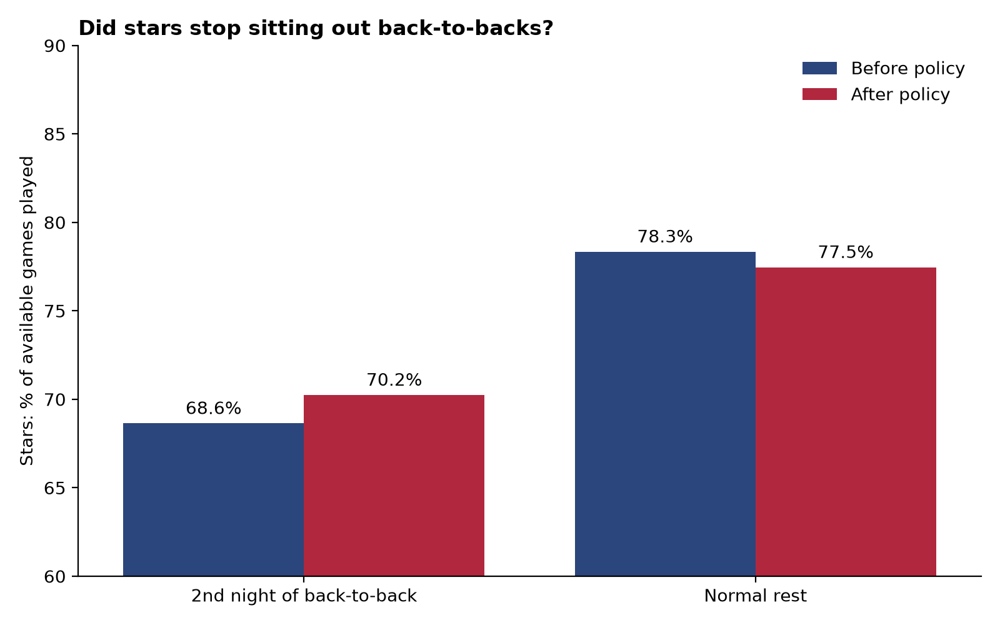
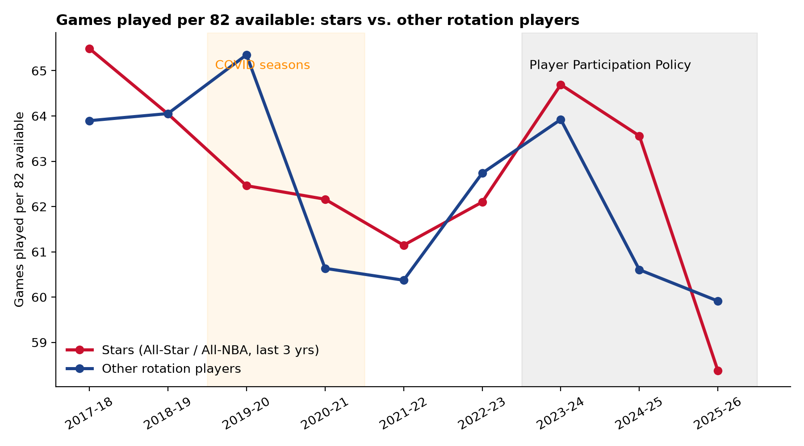
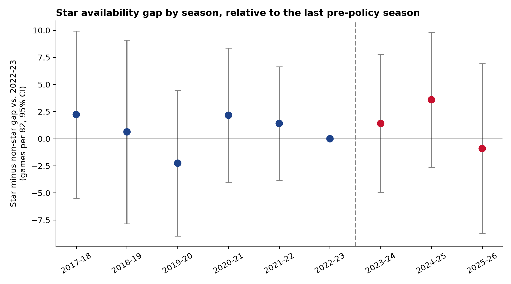

# Did the NBA's Player Participation Policy Work?

**Finding:** The 2023-24 Player Participation Policy did what it was designed to do. Stars became **4.4 percentage points more likely to play the second night of a back-to-back** (p = 0.006), the games where teams used to rest them most. But stars did **not** play more games overall: the change was **+0.7 games per season**, too small to tell apart from zero. Planned rest went down, while missed games from other causes, mostly injuries, stayed about the same. In 2025-26, star availability hit its lowest point in the data.

The results hold under two different definitions of "star" and with the COVID seasons removed.





| Model | Effect | 95% range | p-value |
|---|---|---|---|
| Total games played, official stars | +0.7 games / season | −3.1 to +4.6 | 0.72 |
| Total games played, broad stars | +0.7 games / season | −3.1 to +4.6 | 0.71 |
| Total games played, official stars, no COVID seasons | +0.4 games / season | −3.7 to +4.5 | 0.84 |
| **Back-to-back 2nd nights, official stars** | **+4.4 pp** | +1.2 to +7.6 pp | **0.006** |
| **Back-to-back 2nd nights, broad stars** | **+4.8 pp** | +1.8 to +7.8 pp | **0.002** |

## Why it matters

Before 2023-24, teams often rested healthy stars, most often on the second night of back-to-backs. That hurts fans who buy tickets to see a specific player and broadcast partners who pay for national TV games. The NBA responded with the Player Participation Policy, which requires stars to be available for nationally televised and In-Season Tournament games and limits how many stars a team can rest at once. At the same time, the new labor agreement made players eligible for MVP and All-NBA only if they play 65 games.

This analysis asks whether stars actually played more after the policy, and where the change happened.

## Methodology

### Data
Official NBA game logs from stats.nba.com, accessed with [`nba_api`](https://github.com/swar/nba_api):
- regular-season player and team game logs, 2016-17 to 2025-26
- playoff game logs, 2014-15 to 2025-26
- player awards: All-Star, All-NBA, All-Defensive
- player tracking and hustle stats, games started, and team defensive ratings

The analysis covers **2017-18 to 2025-26**: six seasons before the policy and three after. Earlier seasons are used only to decide who counts as a star.

### Who counts as a star?
Stars are decided **only from earlier seasons**. If a player's star status depended on the same season, healthy players would be more likely to make the All-Star team that year, which would bias the comparison.

**Official stars** use the NBA's own definition from the policy: an All-Star or All-NBA selection in any of the 3 previous seasons. These are the players the policy actually applied to. About 37–49 per season.

**Broad stars** add players the awards miss, such as elite defenders and proven playoff performers who don't score enough to make All-Star teams. About 38–52 per season. A player qualifies through any of these:
- **Official star**, as above.
- **Defensive star:** top 15 in the Defensive Star Rating (below) among full-time starters (27+ minutes per game, 50+ starts) in at least 2 of the last 3 seasons.
- **Sustained playoff performer:** top 30 in playoff Game Score per game in each of the last 3 playoffs, with at least 4 games each. One deep playoff run by a role player isn't enough.

Broad stars must also have played at least 25% of their team's games the previous season. That removes players coming off season-long injuries, like Klay Thompson in 2021-22 or Kevin Durant in 2020-21, but keeps load-managed stars, who are the players the policy was aimed at.

### Defensive Star Rating (DSR)
Awards miss many defenders, so I built a rating from three equally weighted parts. Each stat is measured per 36 minutes and turned into a z-score among rotation players that season.

| Part | Stats |
|---|---|
| Shot defense | Makes prevented: (opponents' usual FG% − their FG% when he is the closest defender) × shots defended. Also contested shots. |
| Disruption | Steals, blocks, deflections, charges drawn, defensive loose balls recovered |
| Team impact | Defensive win shares; team defensive rating minus defensive rating with him on the floor |

Two design choices:
- **Per-36 rates, not totals.** Totals would reward players for playing more games, which is the outcome being studied.
- **Compared with his own team.** Without this, every player on a great defensive team looks elite. In an early version, five Thunder players made the 2025-26 top 10.

**Validation:** DSR never uses awards, but it agrees with the All-Defensive Team voting at an **AUC of 0.89**. A randomly chosen All-Defensive player is rated above a random non-pick 89% of the time.

### Measuring availability
For every player-season, the player is counted as available for every game his team played from his first appearance to the end of the regular season. After a trade, games count for his new team. **Played** = he appeared in that game. That gives about 160,000 player-games.

The sample is rotation players: 20+ minutes per game and 25%+ of team games played the previous season.

### Difference-in-differences
Star availability could rise or fall for reasons unrelated to the policy, such as injury trends or schedule changes. To separate those out, I compare the **change for stars** with the **change for other rotation players**, who the policy didn't cover:

```
played = β · star × post + star + season fixed effects
```

β is the policy effect. Standard errors are clustered by player. The back-to-back result adds a third comparison (star × back-to-back 2nd night × post) to test whether the effect concentrated on the games where resting was most common.

**Parallel trends check:** difference-in-differences assumes stars and non-stars were on similar paths before the policy. The event study below shows the star vs. non-star gap each season compared with 2022-23. Before the policy, every season's gap is close to zero.



## Limitations
- **Rest vs. injury:** game logs don't say why a player missed a game, so planned rest and injuries can't be separated directly. The back-to-back analysis is the closest available test of rest specifically.
- **The 25% prior-season cutoff** leaves out a few important seasons. The biggest is Kawhi Leonard in 2018-19, the season most associated with load management, because he played only 9 games the year before.
- **Only three seasons since the policy,** so the estimates have wide ranges. The overall effect could be a few games in either direction.
- **Several changes started in 2023-24 together** (the participation rules for national TV and In-Season Tournament games, plus the 65-game minimum for awards), and this analysis measures their combined effect.
- **Availability starts at a player's first appearance,** so a star injured for the entire season doesn't appear in that season's data.

## How to run

```bash
pip install -r requirements.txt
python src/pull_data.py        # game logs (≈2 min)
python src/pull_awards.py      # awards for ~650 players (≈10 min)
python src/pull_defense.py     # tracking, hustle, starts, team defense
python src/defense_rating.py   # Defensive Star Rating
python src/stars.py            # star definitions
python src/availability.py     # player-game panel
python src/analysis.py         # regressions and charts
```

Downloaded data goes to `data/raw/` (not committed; the scripts recreate it). Results are written to `results/` and charts to `figures/`.

## Repo structure

```
src/            data pulls, ratings, star definitions, analysis
data/processed/ star definitions, defensive ratings, player-game panel
results/        regression output (did_results.csv, event_study.csv)
figures/        charts
```

---
*Akachidike David Nweze, Data Science, New Jersey Institute of Technology*
